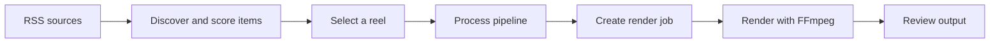
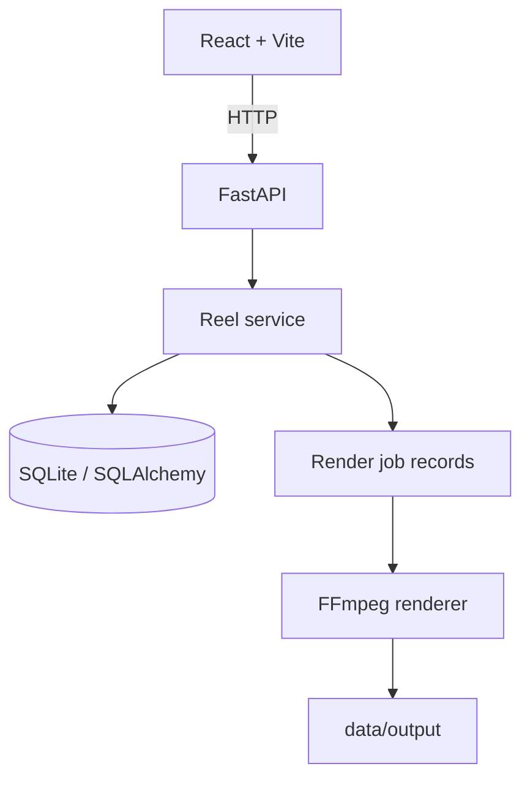

# 🎬 AI Reel Factory

**Turn ideas into short-form video drafts from one workspace.**

AI Reel Factory is an actively developed MVP for discovering topics, managing reel records, running a content-processing pipeline, and tracking render jobs. It combines a React/Vite frontend with a FastAPI backend and a local-first SQLite database.


> **Project status:** development MVP, not production-ready. Mock mode is intended for local workflow testing; it writes placeholder content rather than a playable MP4. Review the security and known-limitations notes before exposing the API to a network.

## Contents

- [What it does](#what-it-does)
- [Workflow](#workflow)
- [Architecture](#architecture)
- [Tech stack](#tech-stack)
- [Run locally](#run-locally)
- [API endpoints](#api-endpoints)
- [Tests](#tests)
- [Repository layout](#repository-layout)
- [Known limitations](#known-limitations)
- [Security notes](#security-notes)
- [Roadmap](#roadmap)

## What it does

| Area | Current purpose |
| --- | --- |
| Topic discovery | Pulls items from configured RSS feeds and scores them for relevance. |
| Reel records | Stores reel source, title, summary, score, script, and processing status. |
| Processing pipeline | Moves a selected discovery through research/script/storyboard stages. |
| Render jobs | Creates a job record and exposes job status/progress. |
| Video output | Uses FFmpeg for a rendered video when mock mode is disabled and FFmpeg is configured. |
| Web UI | React/Vite screens for discovery, reel creation, library/editor, analytics, calendar, jobs, and templates are under active development. |

## Workflow



With `MOCK_MODE=true`, the service uses a lightweight placeholder output to exercise parts of the workflow; it is **not a playable video file**. Set `MOCK_MODE=false` and configure FFmpeg to attempt actual video rendering.

## Architecture



## Tech stack

- **Frontend:** React, Vite, React Router, Axios, Framer Motion
- **Backend:** Python, FastAPI, Pydantic Settings, SQLAlchemy
- **Storage:** SQLite by default; configurable with `DATABASE_URL`
- **Rendering:** FFmpeg when mock mode is disabled
- **Testing:** pytest and FastAPI's test client

## Run locally

### Prerequisites

- Python 3.11 or newer
- Node.js and npm
- Git
- FFmpeg and a compatible DejaVu font installation for real video rendering; mock mode does not require FFmpeg

### 1. Clone the repository

```bash
git clone https://github.com/hemanth-kumar-boddeda/Ai-Reel-Factory.git
cd Ai-Reel-Factory
```

### 2. Set up the backend

**Windows PowerShell**

```powershell
py -m venv .venv
.\.venv\Scripts\Activate.ps1
python -m pip install --upgrade pip
pip install -r requirements.txt
Copy-Item .env.example .env
New-Item -ItemType Directory -Force data | Out-Null
```

**macOS / Linux**

```bash
python3 -m venv .venv
source .venv/bin/activate
python -m pip install --upgrade pip
pip install -r requirements.txt
cp .env.example .env
mkdir -p data
```

Keep `MOCK_MODE=true` in `.env` to exercise the development workflow without rendering real video. The default database URL is `sqlite:///./data/reels.db`.

Start the API from the repository root:

```bash
uvicorn app.main:app --reload --port 8000
```

Open **[http://localhost:8000/docs](http://localhost:8000/docs)** for the interactive API documentation.

### 3. Set up the frontend

```bash
cd frontend
npm ci
npm run dev
```

Vite normally serves the UI at **[http://localhost:5173](http://localhost:5173)**. The checked-in frontend is still being integrated; its current entry-point imports need to be resolved before a successful build can be guaranteed. See [Known limitations](#known-limitations).

## API endpoints

| Method | Endpoint | Purpose |
| --- | --- | --- |
| `GET` | `/api/reels` | List reel records |
| `POST` | `/api/reels` | Create a reel record |
| `GET` | `/api/reel/{reel_id}` | Retrieve a reel |
| `PUT` | `/api/reel/{reel_id}` | Update a reel |
| `GET` | `/api/stats` | Get reel counts by status |
| `POST` | `/api/reels/{reel_id}/render` | Start a render job |
| `GET` | `/api/jobs/{job_id}` | Retrieve job status |
| `GET` | `/video/{reel_id}` | Serve a generated video when available |
| `POST` | `/run` | Trigger the RSS processing pipeline |

For request/response schemas, use `/docs` while the backend is running.

## Tests

Install the test dependencies and run pytest from the repository root:

```bash
pip install -r requirements-test.txt
python -m pytest
```

The test suite uses an in-memory SQLite database for its fixtures. Test results should be checked locally before treating a change as verified.

## Repository layout

```text
Ai-Reel-Factory/
├── app/                    # FastAPI app, models, schemas, repositories and services
│   ├── core/                # Application configuration
│   ├── models/              # SQLAlchemy models
│   ├── repositories/        # Persistence operations
│   ├── schemas/              # API schemas
│   └── services/             # Pipeline and rendering logic
├── frontend/                # React + Vite application
├── tests/                   # Backend API and processing tests
├── data/                    # Local SQLite database and generated output (ignored)
├── .env.example              # Safe example environment settings
├── requirements.txt          # Root backend install entry point
└── requirements-test.txt     # Test dependencies
```

## Known limitations

- The frontend's current `App.jsx` and `main.jsx` reference modules that are not present in the current repository tree, so the frontend build is not yet verified.
- Several visible frontend screens are placeholders or are still being implemented.
- Mock mode produces placeholder content rather than a valid, playable MP4.
- Real rendering depends on a working FFmpeg installation and the configured font path.
- The API does not currently implement authentication or authorization. Do not expose it publicly or deploy it with sensitive data.
- Provider/publishing credentials are examples only; having environment-variable placeholders does not mean those integrations are fully implemented.

## Security notes

- Keep `.env`, real API keys, access tokens, and passwords out of Git.
- Do not commit local SQLite databases, generated reels, logs, backups, temporary files, or runtime output.
- If a credential was ever committed, rotate it. Removing the file in a later commit does not erase it from Git history.
- Bind the local service only to a trusted environment until authentication, authorization, and deployment settings have been reviewed.

## Roadmap

- [ ] Restore and verify the missing frontend entry-point modules.
- [ ] Add CI checks for frontend build and backend tests.
- [ ] Verify the complete create → process → render → review flow on a clean clone.
- [ ] Add product screenshots and a short demo clip.
- [ ] Complete provider configuration and document verified integrations.
- [ ] Add authentication, authorization, production configuration, and operational logging.
- [ ] Add an appropriate project license.

## Contributing

Focused bug reports and contributions are welcome. Open an issue with reproduction steps, expected behavior, actual behavior, and relevant **redacted** logs. Keep pull requests focused and run relevant checks before submitting.

## License

No license has been specified yet. Until a license is added, do not assume the project is available for unrestricted reuse, redistribution, or modification.
