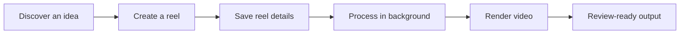
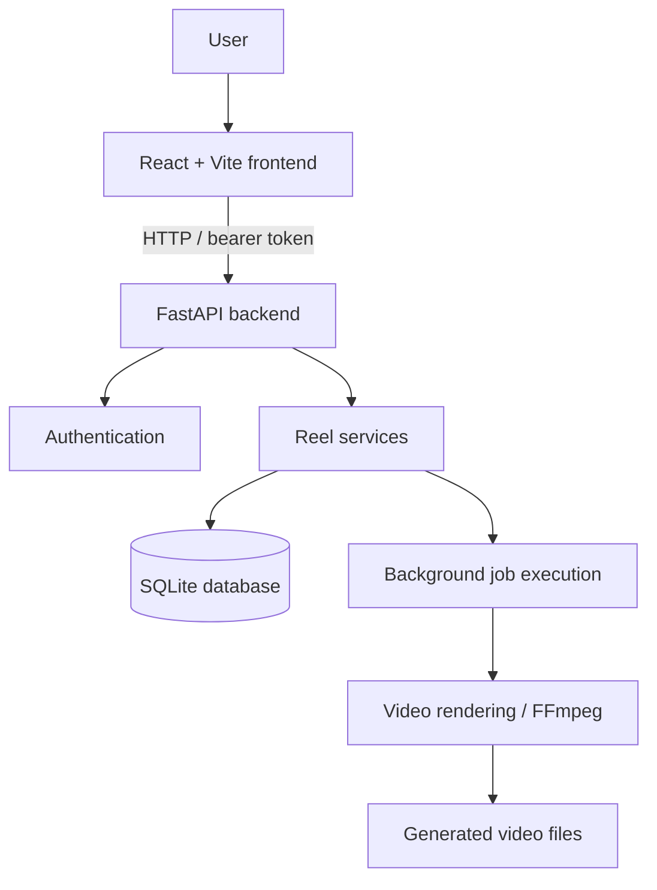

🎬 AI Reel Factory
From an idea to a review-ready reel — in one workspace.
AI Reel Factory is an actively developed MVP for managing short-form video workflows: discover ideas, create reels, track processing, and review generated output in one place.

  
  
  
  
  
  

Explore the repository · Report a bug · Request a feature
Project status: MVP / active development. The local mocked reel-processing flow is available for development. External provider integrations, deployment, and production hardening may vary with the current configuration and remain areas of ongoing work.

✨ At a glance
Area	What it does
📊 Dashboard	View the reel workspace and processing overview.
🔎 Discover	Explore the discovery area for potential reel ideas.
🎬 Create Reel	Start a reel by entering its source and creative settings.
🗂️ Projects	Track reels and their processing states.
⚙️ Settings	Access application configuration.
✅ Review flow	Move processed output into a review-ready state.

🚀 Workflow

In local development, MOCK_MODE=true allows the pipeline to be exercised without requiring every external AI provider to be configured.
💡 Highlights
- Workspace-oriented UI for dashboard, discovery, reel creation, projects, and settings.
- FastAPI backend for reel management and processing APIs.
- Authenticated API flow using bearer-token authentication.
- Background processing option for reel jobs.
- Video output pipeline with FFmpeg-based rendering and validation tooling.
- Local-first development using SQLite by default, configurable through environment variables.
- Test and smoke-test tooling for checking key backend and frontend flows as the project evolves.
🏗️ Architecture

Layer	Technology / responsibility
Frontend	React, Vite, JavaScript, API client
Backend	Python, FastAPI, SQLAlchemy
Authentication	Login endpoint and bearer-token protected requests
Persistence	SQLite by default; database URL is configurable
Processing	Background execution option, reel services, FFmpeg video output
Tests and utilities	Backend tests and development smoke-test scripts

⚡ Run locally
Prerequisites
- Python 3.11+ recommended (the project has also been exercised with Python 3.13)
- Node.js and npm
- FFmpeg available on your PATH for video-rendering workflows
- Git
1. Clone the repository
git clone https://github.com/hemanth-kumar-boddeda/Ai-Reel-Factory.git
cd Ai-Reel-Factory
2. Configure and run the backend
From the repository root, create a virtual environment and install dependencies.
Windows PowerShell
py -m venv .venv
.\.venv\Scripts\Activate.ps1
python -m pip install --upgrade pip
pip install -r requirements.txt
Copy-Item .env.example .env
macOS / Linux
python3 -m venv .venv
source .venv/bin/activate
python -m pip install --upgrade pip
pip install -r requirements.txt
cp .env.example .env
Open .env and configure the values documented in .env.example. For a local mock-mode run, the project has used these settings:
MOCK_MODE=true
JOB_QUEUE_BACKEND=background
DATABASE_URL is optional when using the project's default SQLite database. Never commit .env, API keys, passwords, access tokens, local databases, or generated videos.
Start the API server:
uvicorn app.main:app --reload --port 8002
API documentation should be available at http://localhost:8002/docs while the backend is running.
3. Run the frontend
Open a second terminal from the repository root:
cd frontend
npm install
npm run dev
Open http://localhost:5173. Keep the backend running on port 8002 as well. If the browser cannot reach the API, check backend logs and the project's CORS/API URL configuration before changing application code.
4. Build and test
Build the frontend:
cd frontend
npm run build
Run backend tests from the repository root (once development dependencies are installed):
python -m pytest
Use the project-specific smoke-test instructions in scripts/ when verifying API/job-processing behavior. Authenticated checks require a valid account in the active local database; mock mode does not bypass authentication.
🔌 API surface
Endpoint	Purpose
POST /auth/login	Authenticate and return a bearer access token
GET /api/stats	Retrieve reel statistics
GET /api/reels	List the current user's reels
POST /api/reels	Create a reel record and initiate processing as configured
GET /api/reels/{id}	Retrieve a reel by ID

For full request/response schemas, run the API and open /docs.
📁 Repository structure
Ai-Reel-Factory/
├── app/                  # FastAPI app, models, repositories, and services
├── frontend/             # React + Vite web application
├── tests/                # Automated tests
├── scripts/              # Smoke tests and development utilities
├── data/                 # Local runtime data / generated output; do not commit
├── .env.example          # Example environment configuration
└── requirements.txt      # Python dependencies
The exact module set may change during development. Keep runtime data, local databases, rendered videos, logs, backups, and temporary debugging files out of version control unless a fixture is deliberately maintained as source.
🛡️ Security
- Keep real credentials and API keys in local environment variables, never in source control.
- Use .env.example for placeholder settings only.
- Do not upload production data, user records, JWTs, local SQLite databases, or rendered videos.
- Rotate any secret that has accidentally been committed; deleting it in a later commit is not enough.
- Treat this as a development MVP until deployment, provider failure handling, access controls, and operational monitoring have been reviewed for production use.
🗺️ Roadmap
These are potential next milestones, not claims that the features are already complete.
- [ ] Add current product screenshots to the README.
- [ ] Document real-provider setup and supported provider combinations.
- [ ] Add a repeatable end-to-end path for authenticated reel creation through rendered output.
- [ ] Add CI checks for backend tests and the frontend build.
- [ ] Document production deployment, persistent storage, and job-worker configuration.
- [ ] Improve observability for failures across creation, processing, and rendering.
🤝 Contributing
Focused bug reports and contributions are welcome.
1. Create a branch for the task.
2. Keep commits focused on real, reviewable work.
3. Run the relevant tests and frontend build.
4. Describe what changed and what you verified in the pull request.
For bug reports, include the affected workflow, reproduction steps, expected behavior, actual behavior, and relevant redacted logs. Never attach secrets or real user data.

📄 License
No license has been specified in this repository yet. Until a license is added, do not assume the source is available for unrestricted reuse, redistribution, or modification.
